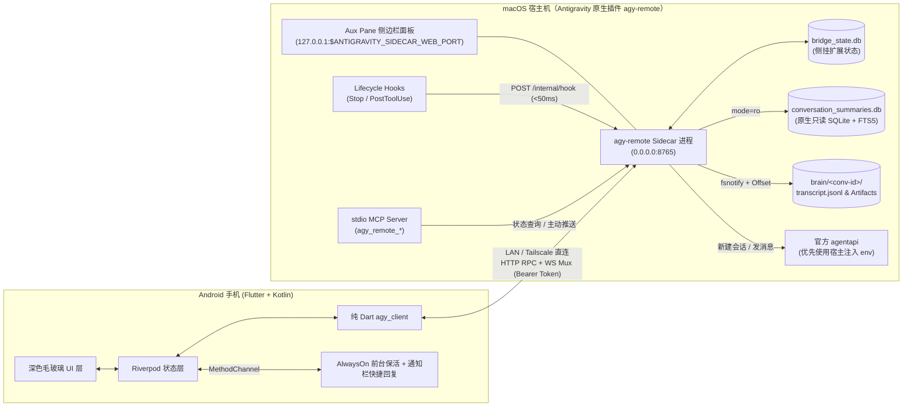

# Antigravity 移动端互通系统（`agy-remote` 插件 + Flutter 安卓客户端）设计规范

- **日期**：2026-11-24（已同步更新 Mac 端 Antigravity 原生插件架构）
- **目标平台**：macOS 宿主机（Antigravity 原生插件 `agy-remote`，Go 单二进制驱动 Sidecar + MCP + Hooks） + Android 客户端（Flutter + Kotlin 原生层，保留 iOS 编译兼容性）
- **参考基线**：Levity 移动端交互形态 + `ccch1mneyyy/dsh-go` 客户端分层与多路复用流式同步思想 + `liguobao/ds-harness-remote` 宿主插件一体化托管与远程工具注入模式（洁净室独立实现）

---

## 1. 背景、目标与范围边界

### 1.1 核心痛点与定位
本项目的目标不是在手机小屏上编写代码，而是将运行在 Mac 上的 **Google Antigravity** 延伸为全天候可随身监控、远程指挥、实时拍板与主动提醒的移动终端：
1. **实时掌控全局状态**：随时查看宿主机直连延迟、`Google AI Ultra` 等订阅层级，以及 `Gemini` 和 `Claude · GPT` 模型池的 `5h`（5小时窗口）与 `7d`（7天周期）剩余配额百分比及重置倒计时。
2. **桌面上下文无缝接力**：与电脑端侧边栏会话保持同步（支持 `桌面顺序` 与 `按项目` 视图），直观展示置顶状态、未读动态、工作区归属（项目目录或 `通用对话`）、当前模型档位、子代理（Subagents）并发数与产物（Artifacts）数量。
3. **远程拍板与产物审阅**：支持在手机端查看流式思考与工具执行摘要、预览桌面端生成的 Artifacts 文档/图片及消息内的本地 `file:///` 引用文件，并在 Agent 停下提问或等待方案确认时远程回复拍板。
4. **锁屏保活与快捷响应**：针对小米 HyperOS 等国产安卓系统提供轻量前台保活服务与系统级高优通知，支持在锁屏/横幅通知栏通过 `RemoteInput` 直接回复或一键确认，无需解锁进入 App。

### 1.2 明确裁剪边界（Non-Goals）
- **不在手机端内置 Linux 容器或本地 Agent 运行时**：所有 Agent 推理、代码读写与 MCP 工具调用均在 Mac 宿主机执行。
- **不直接写入或修改 Antigravity 原生数据库**：对原生 `conversation_summaries.db` 严格采用只读访问，杜绝锁库或损坏桌面端状态的风险。
- **不引入第三方云端数据中转依赖**：业务流量走局域网或 Tailscale / WireGuard 等虚拟局域网点对点直连（同时兼容用户自挂反向代理 / FRP 域名）；不复制任何 `AGPL-3.0` 第三方源码，保持 100% 独立编码。

---

## 2. 系统总体拓扑与目录结构

### 2.1 单仓双端目录规划
工程根目录位于 `/Users/apple/go-project/ai/antigravity-mobile/`：

```text
antigravity-mobile/
├── 2026-11-24-antigravity-mobile-design.md   # 本设计规范文档
├── scripts/
│   └── install-plugin.sh                     # 一键编译 Go 二进制并部署 ~/.gemini/config/plugins/agy-remote/
├── plugin/                                   # Antigravity 原生插件包源码（agy-remote）
│   ├── plugin.json                           # 插件元数据清单（name: agy-remote, logo, suggestedPrompts）
│   ├── mcp_config.json                       # 挂载 stdio MCP Server（agy_remote_* 工具集）
│   ├── hooks.json                            # 挂载 Stop / PostToolUse(ask_question) 零延迟推送 Hook
│   ├── assets/logo.svg                       # 插件矢量图标
│   ├── sidecars/remote/sidecar.json          # Aux Pane 侧边栏常驻 Sidecar（restart_policy: always）
│   ├── skills/agy-remote/SKILL.md            # 插件运行与排障技能
│   └── rules/AGENTS.md                       # 插件常驻引导规则
├── bridge/                                   # Mac 端 Go 核心实现（单二进制 agy-remote 多角色合一）
│   ├── cmd/agy-bridge/                       # CLI 入口（sidecar / mcp / hook / serve / pair / status）
│   ├── internal/
│   │   ├── config/                           # 配置加载、Token 生成、本机 LAN/Tailscale IP 探测
│   │   ├── agyreader/                        # 只读查询 conversation_summaries.db 与 FTS5 搜索
│   │   ├── brainwatcher/                     # fsnotify + 字节偏移增量监听 transcript 与产物目录
│   │   ├── cmdrunner/                        # 优先复用宿主注入的 ANTIGRAVITY_AGENTAPI_EXE / LS_ADDRESS，兜底扫描 daemon/hub_*.json
│   │   ├── statestore/                       # 独立侧挂 SQLite（bridge_state.db）读写
│   │   ├── quotamonitor/                     # 可插拔双模 5h/7d 配额监控与校准引擎
│   │   ├── filesandbox/                      # Artifacts 与工作区 file:// 白名单安全读取器
│   │   ├── notifier/                         # 告警判定器与可选外部 Webhook/ntfy 转发器
│   │   ├── sidecarui/                        # Antigravity Aux Pane 深色毛玻璃控制面板（含 SVG 二维码与测试推送）
│   │   ├── mcpserver/                        # 标准 JSON-RPC 2.0 stdio MCP Server（agy_remote_*）
│   │   └── hubserver/                        # HTTP REST + /api/v1/mux WS 网关 + /internal/hook 本地回调
│   └── go.mod
└── app/                                      # Flutter 客户端工程（同前）
```

### 2.2 端到端连接与数据流拓扑



### 2.3 扫码配对与网络多路择优
1. **服务端生成配对载荷**：执行 `agy-bridge pair`（或首次 `serve`）时，自动枚举本机局域网 IPv4（如 `192.168.x.x`）与 Tailscale / utun 虚拟网段 IP（`100.64.0.0/10`），生成 256-bit 随机设备预共享密钥，在终端渲染二维码。二维码 JSON 载荷格式如下：
   ```json
   {
     "v": 1,
     "hostName": "ClawStation",
     "endpoints": ["http://192.168.31.88:8765", "http://100.101.102.103:8765"],
     "token": "agy_live_xxxxxxxxxxxxxxxxxxxxxxxxxxxxxxxx"
   }
   ```
   用户亦可在配置中追加自定义反向代理 / FRP HTTPS 地址。
2. **客户端并发探测择优**：`agy_client` 连接时对 `endpoints` 并发发起带 1.5s 超时的 `/api/v1/health` 握手，优先选用响应最快且可达的地址：
   - 命中局域网或 `100.64.0.0/10` 网段时，UI 标记为 `已直连 (<RTT>ms)`；
   - 命中外部公网转发域名时，UI 标记为 `中继连接 (<RTT>ms)`。
3. **鉴权安全**：除 `/api/v1/health` 仅返回协议版本与在线标识外，所有 HTTP 与 WebSocket 握手均强制校验 `Authorization: Bearer <token>`（WS 支持首帧鉴权或 Header 鉴权，URL Query 不携带明文 Token 以免泄漏到日志）。

---

## 3. Antigravity 本地数据源映射规范

基于对 macOS 本机 `~/.gemini/antigravity/` 的实测结构，各业务字段的数据源映射规则如下：

| 业务概念 | 本地物理数据源 | 提取与转换规则 |
| :--- | :--- | :--- |
| **根会话列表** | `conversation_summaries.db` → `conversation_summaries` 表 | 筛选 `nesting_depth = 0 AND killed = 0`；默认按置顶优先 + `last_modified_time DESC` 排序 |
| **工作区标签** | `conversation_summaries.workspace_uris` | JSON 字符串数组：若为 `[]` 则映射为 `{kind: "global", label: "通用对话"}`；若非空（如 `["file:///Users/apple/go-project/ai"]`），提取首个 URI 的目录 basename 作为 `{kind: "workspace", label: "ai", rootPath: "/Users/apple/go-project/ai"}` |
| **运行态判断** | `conversation_summaries.status` 与 `not_fully_idle` | `status == "CASCADE_RUN_STATUS_RUNNING"` 或 `not_fully_idle == 1` 判定为运行中（`running`），否则为空闲（`idle`） |
| **子代理计数 (`⑂ N 子代理`)** | `conversation_parents` 表 + `conversation_summaries.parent_conversation_id` | 递归或关联统计归属于当前根 `conversation_id` 的后代子会话总数 `subagentCount` |
| **全文检索 (`🔍`)** | `conversation_summaries.db` → `conversations_fts` (FTS5) | 使用 `MATCH` 检索 `title, workspace, project, user_body, agent_body`，按 BM25 权重及最新活跃时间返回命中会话与高亮片段 |
| **模型档位与消息流** | `brain/<conv-id>/.system_generated/logs/transcript.jsonl` | 按行解析 JSON：从最新 `PLANNER_RESPONSE` 提取 `model` 字段并映射展示名；若某行含 `truncated_fields`，按相同行号定点回读 `transcript_full.jsonl` 补全内容 |
| **产物列表 (`📄 N 产物`)** | `brain/<conv-id>/` 目录扫描 | 递归扫描该会话目录，**排除** `.system_generated/`、`.user_uploaded/`、`scratch/`、`browser_sandbox/` 及以 `.` 开头的隐藏文件；统计剩余文件数为 `artifactCount`（为 `0` 时前端隐藏角标） |
| **远程新建会话 / 发消息** | `~/.gemini/antigravity/daemon/hub_*.json` + `~/.gemini/antigravity/bin/agentapi` | 扫描 `daemon/hub_*.json`，校验对应 `pid` 进程存活，构造 `ANTIGRAVITY_LS_ADDRESS` 环境变量调用官方 `agentapi new-conversation` 或 `agentapi send-message` |

---

## 4. Go 桥接守护服务详细设计（`bridge/`）

### 4.1 侧挂状态数据库（`bridge_state.db`）
存放在 `~/.config/antigravity-mobile/bridge_state.db`，使用纯 Go SQLite 驱动（`modernc.org/sqlite`）开启 WAL 模式，表结构如下：

```sql
-- 已授权设备与访问凭据
CREATE TABLE IF NOT EXISTS paired_devices (
    device_id TEXT PRIMARY KEY,
    device_name TEXT NOT NULL,
    token_hash TEXT NOT NULL UNIQUE,
    created_at INTEGER NOT NULL,
    last_seen_at INTEGER NOT NULL
);

-- 会话移动端扩展元数据（置顶与已读游标）
CREATE TABLE IF NOT EXISTS session_meta (
    conversation_id TEXT PRIMARY KEY,
    pinned INTEGER NOT NULL DEFAULT 0,
    pinned_order INTEGER NOT NULL DEFAULT 0,
    last_read_step_index INTEGER NOT NULL DEFAULT -1,
    updated_at INTEGER NOT NULL
);

-- 本地 transcript Token/轮次增量账本（供 5h/7d 配额窗口高速聚合）
CREATE TABLE IF NOT EXISTS usage_ledger (
    conversation_id TEXT NOT NULL,
    step_index INTEGER NOT NULL,
    created_at_unix INTEGER NOT NULL,
    pool_id TEXT NOT NULL,          -- 'gemini' | 'claude_gpt'
    model TEXT NOT NULL,
    input_tokens INTEGER NOT NULL DEFAULT 0,
    cache_read_tokens INTEGER NOT NULL DEFAULT 0,
    output_tokens INTEGER NOT NULL DEFAULT 0,
    PRIMARY KEY (conversation_id, step_index)
);
CREATE INDEX IF NOT EXISTS idx_usage_ledger_pool_time ON usage_ledger(pool_id, created_at_unix);

-- 配额预算与手动校准基准配置
CREATE TABLE IF NOT EXISTS quota_configs (
    pool_id TEXT PRIMARY KEY,       -- 'gemini' | 'claude_gpt'
    window_5h_budget INTEGER NOT NULL,
    window_7d_budget INTEGER NOT NULL,
    calibrated_at_unix INTEGER NOT NULL DEFAULT 0,
    calibrated_5h_pct REAL,
    calibrated_7d_pct REAL,
    subscription_label TEXT NOT NULL DEFAULT 'Google AI Ultra'
);

-- 文件扫描偏移游标（避免重启后全量重扫全部历史 transcript）
CREATE TABLE IF NOT EXISTS watcher_offsets (
    conversation_id TEXT PRIMARY KEY,
    byte_offset INTEGER NOT NULL DEFAULT 0,
    last_mtime_ns INTEGER NOT NULL DEFAULT 0
);

-- 可选外部推送通道（ntfy / Gotify / 通用 Webhook）
CREATE TABLE IF NOT EXISTS webhook_endpoints (
    id TEXT PRIMARY KEY,
    name TEXT NOT NULL,
    kind TEXT NOT NULL,             -- 'ntfy' | 'gotify' | 'webhook'
    url TEXT NOT NULL,
    auth_header TEXT NOT NULL DEFAULT '',
    enabled INTEGER NOT NULL DEFAULT 1,
    created_at INTEGER NOT NULL
);
```

### 4.2 未读状态与置顶排序逻辑
- **未读蓝点判定**：当原生库中会话的 `step_count - 1 > session_meta.last_read_step_index` 且最新一步不是当前手机端刚刚发出的 `USER_INPUT` 时，`unread = true`（前端卡片左上角显示蓝点 `●`；已读且 `pinned = 1` 显示紫色图钉 `📌`）。
- **双视图排序**：
  - `桌面顺序 (desktop)`：置顶区（`pinned = 1` 按 `pinned_order ASC, last_modified_time DESC`）在前，常规区按 `last_modified_time DESC` 排列。
  - `按项目 (project)`：按 `workspace.label` 分组（各组按组内最新会话活跃时间降序，`通用对话` 固定作为独立分组），组内会话按 `last_modified_time DESC` 排列。

### 4.3 可插拔双模配额引擎（`quotamonitor`）
定义统一接口：
```go
type QuotaSnapshot struct {
    SubscriptionTier string      `json:"subscriptionTier"`
    UpdatedAt        int64       `json:"updatedAt"`
    Pools            []PoolQuota `json:"pools"`
}

type PoolQuota struct {
    PoolID         string `json:"poolId"`         // "gemini" | "claude_gpt"
    DisplayName    string `json:"displayName"`    // "Gemini" | "Claude · GPT"
    Remaining5hPct int    `json:"remaining5hPct"` // 0..100
    Reset5hAt      *int64 `json:"reset5hAt"`      // 满额时为 null，否则为 Unix 秒级时间戳
    Remaining7dPct int    `json:"remaining7dPct"` // 0..100
    Reset7dAt      *int64 `json:"reset7dAt"`      // 满额时为 null
    Level          string `json:"level"`          // "full" (100%) | "normal" (40..99%) | "warning" (<40%)
    Source         string `json:"source"`         // "direct" | "ledger" | "gateway"
}
```
1. **Provider 优先级链**：`LanguageServerProvider` 优先（通过本机回环调用官方 `LanguageServerService/GetUserStatus`，直读真实 `userTier.name` 订阅等级与各模型池权威 `remainingFraction` / `resetTime`，并支持自定义外部网关 Provider）；当桌面端未运行时自动回退至 `LedgerWindowProvider`。
2. **本地滑动窗口与校准计算（`LedgerWindowProvider`）**：
   - `brainwatcher` 每监听到新的 `PLANNER_RESPONSE`，按 `model` 名称归类写入 `usage_ledger`（包含 `gemini` 前缀归入 `gemini` 池，包含 `claude` / `gpt` / `o1` / `o3` 归入 `claude_gpt` 池），计算等效消耗权重 `cost = input_tokens + output_tokens * 4 + cache_read_tokens / 10`（同时保留请求次数统计）。
   - 对任一时间窗口 $W \in \{5\text{h}, 7\text{d}\}$：查询 `created_at_unix >= now - W` 内的累计消耗 `usedCost` 与最早一条记录时间 `oldestUnix`。
   - 若 `usedCost == 0`：`remainingPct = 100`，`resetAt = null`（前端显示 `满额`）。
   - 若 `usedCost > 0`：`remainingPct = clamp(round((1 - usedCost / budget) * 100), 0, 99)`，`resetAt = oldestUnix + W`（当最早一笔消耗滑出窗口即开始恢复额度，若用户执行了手动百分比校准，则基于校准时刻的 `usedCost` 反推更新对应 `budget`，确保百分比与桌面端体感一致）。
   - **视觉状态分级**：`min(remaining5hPct, remaining7dPct) == 100` 为 `full`（绿点）；`< 40` 为 `warning`（橙点 + 橙色进度条）；其余为 `normal`。

### 4.4 Artifacts 与本地 `file://` 安全沙箱（`filesandbox`）
当手机端请求预览产物或点击消息中的 `[doc.md](file:///Users/...)` 时，必须经过以下 4 道安全闸门：
1. **规范化与符号链接消解**：对目标路径执行 `filepath.Clean` 与 `filepath.EvalSymlinks`，拒绝不存在或非普通文件（如设备文件、目录、Socket）。
2. **会话作用域白名单校验**：消解后的真实绝对路径必须严格位于以下目录之一的前缀下（按路径分段匹配，防止 `/path/ai-secret` 匹配 `/path/ai`）：
   - `~/.gemini/antigravity/brain/<conv-id>/`
   - 该会话 `workspace_uris` 解析出的本地工作区根目录
3. **敏感文件黑名单拦截**：拒绝读取文件名匹配 `.env`、`.env.*`、`*.pem`、`*.key`、`*.p12`、`id_rsa*`、`id_ed25519*`、`*credentials*`、`*secret*` 及 `.git/` 内部对象的文件，返回 `PATH_FORBIDDEN`。
4. **体积保护与流式分类**：
   - 图片/音频/PDF 等媒体走 `GET /api/v1/files/raw?convId=...&path=...`（支持 HTTP `Range` 请求与 ETag 缓存，单文件上限 20MB）。
   - Markdown / 代码 / 纯文本走 `GET /api/v1/files/content?convId=...&path=...&offset=0&limit=524288`：单次最多返回 `512KB` UTF-8 文本，超出时标记 `truncated: true` 与 `totalBytes`，供客户端按需加载后续分块。

### 4.5 Antigravity 原生插件化集成（`agy-remote`）
借鉴 `liguobao/ds-harness-remote` 将远程桥接直接托管于宿主插件生命周期的思想，Mac 端以标准 Antigravity 插件形态部署至 `~/.gemini/config/plugins/agy-remote/`，单一 Go 二进制 `bin/agy-remote` 承担 4 种运行角色（仍保留 `serve / pair / status` 独立 CLI 兼容）：

1. **托管常驻 Sidecar + Aux Pane UI 面板（`sidecars/remote/sidecar.json`）**：
   - 配置 `"restart_policy": "always"` 与 `SIDECAR_UI_ENTRYPOINT_AUX_PANE`，随 Antigravity 启动自动拉起、关闭插件自动退出，免去手动开终端或写 `launchd` 配置。
   - 同时监听 `0.0.0.0:8765`（服务手机 App）与 `127.0.0.1:$ANTIGRAVITY_SIDECAR_WEB_PORT`（服务 Antigravity 侧边栏，校验 `x-sidecar-token`）。
   - 在侧边栏 `[agy-remote](sidecar://agy-remote/remote/)` 中直接渲染高清 SVG 扫码二维码、LAN/Tailscale 直连端点、在线手机计数、`5h/7d` 配额实时进度条、一键复制配对 JSON、一键重置 Token 与一键测试推送按钮。
   - 自动优先复用 Antigravity 注入的 `ANTIGRAVITY_AGENTAPI_EXE` 与 `ANTIGRAVITY_LS_ADDRESS`，独立运行模式下自动回退扫描 `~/.gemini/antigravity/daemon/hub_*.json`。
2. **Lifecycle Hooks 零延迟推送（`hooks.json`）**：
   - 在插件根目录注册 `Stop` 与 `PostToolUse(matcher: "ask_question")` 命令 Hook（`./bin/agy-remote hook <event>`，3 秒超时，始终输出 `{}` 绝不阻塞 Agent 循环）。
   - 当 Agent 回合结束或发起提问时，Hook 通过本机回环直连 `POST http://127.0.0.1:8765/internal/hook` 触发 WebSocket `alert` 广播，将手机推送延迟从秒级轮询缩短至 50ms 以内。
3. **内置 stdio MCP Server（`mcp_config.json`）**：
   - 通过 `${PLUGIN_ROOT}/bin/agy-remote mcp` 暴露三个 `agy_remote_` 前缀工具：`agy_remote_status`（健康与配额诊断）、`agy_remote_pairing_info`（配对信息引导）、`agy_remote_notify_mobile`（允许 Agent 或 `/schedule` 定时任务主动向手机发送带快捷回复按钮的高优推送，例如早安简报、作息提醒与里程碑确认）。
4. **插件级 Skill 与 Rules（`skills/agy-remote/SKILL.md`、`rules/AGENTS.md`）**：
   - 指导 Agent 优先通过 MCP 工具与 `[agy-remote](sidecar://agy-remote/remote/)` 侧边栏协助用户完成配对、状态排查和手机主动触达。

---

## 5. 通信协议契约（REST + WebSocket Mux）

### 5.1 统一 HTTP RPC 接口（`POST /api/v1/rpc`）
请求体：
```json
{
  "requestId": "req_01JXXXXXX",
  "method": "sessions.sendMessage",
  "params": {
    "conversationId": "90ab5abf-9a8f-473d-a0f0-dee395bf23ea",
    "content": "确认方案 1，直接开工吧"
  }
}
```
响应体（业务层固定返回 `HTTP 200`，传输鉴权失败返回 `HTTP 401`）：
```json
{
  "requestId": "req_01JXXXXXX",
  "ok": true,
  "data": { "accepted": true }
}
```
失败时：
```json
{
  "requestId": "req_01JXXXXXX",
  "ok": false,
  "error": {
    "code": "DESKTOP_OFFLINE",
    "message": "Mac 端 Antigravity 桌面进程当前未运行，无法投递新消息（历史会话与产物仍可正常查阅）"
  }
}
```

#### 核心 RPC 方法表
| `method` | 参数摘要 | 返回说明 |
| :--- | :--- | :--- |
| `host.info` | `{}` | 返回主机名、系统版本、桌面进程存活态、支持的工作区历史列表 |
| `quota.get` | `{}` | 返回最新 `QuotaSnapshot` |
| `quota.calibrate` | `{ poolId, remaining5hPct?, remaining7dPct?, subscriptionTier? }` | 更新配额校准基准并返回重算后的 `QuotaSnapshot` |
| `sessions.list` | `{ mode: "desktop"\|"project", limit?, cursor? }` | 返回置顶组 + 主列表会话卡片数据（含子代理数、产物数、未读态、最新摘要） |
| `sessions.search` | `{ query, limit? }` | 基于 `conversations_fts` 返回全文命中列表与匹配上下文片段 |
| `sessions.get` | `{ conversationId, beforeStep?, limit? }` | 分页拉取会话完整聊天记录与当前产物清单 |
| `sessions.create` | `{ prompt, title?, model?, workspacePath? }` | 调用官方 `agentapi new-conversation` 创建新会话（幂等校验 `requestId`） |
| `sessions.sendMessage` | `{ conversationId, content }` | 调用官方 `agentapi send-message` 向目标会话追加消息或回复决策确认 |
| `sessions.pin` | `{ conversationId, pinned, order? }` | 设置或取消会话置顶 |
| `sessions.markRead` | `{ conversationId, stepIndex }` | 更新该会话已读步数游标，消除未读蓝点 |
| `artifacts.list` | `{ conversationId }` | 返回该会话 Brain 目录下的全部可见产物列表（文件名、相对路径、大小、修改时间、类型） |

### 5.2 多路复用实时流（`GET /api/v1/mux` WebSocket）
参考 `dsh-go` 的**「单世代快照 + 连续 `seq` 增量事件」**契约，单条 WebSocket 承载心跳延迟测算、全局状态广播与当前打开会话的流式同步：

1. **心跳帧（每 10 秒一次）**：
   - 客户端发：`{"type": "ping", "clientTs": 1795527000123}`
   - 服务端回：`{"type": "pong", "clientTs": 1795527000123, "serverTs": 1795527000134, "desktopOnline": true}`
   - 客户端据此计算 `rttMs = now - clientTs` 更新顶栏 `21ms`。
2. **频道订阅与快照/增量同步**：
   - 客户端连接建立后默认自动订阅 `$global` 频道（推送会话卡片变更、配额刷新与跨会话 `alert` 通知）；进入某个会话详情页时发送 `{"type": "sub", "channel": "session:<convId>"}`，退出时发 `unsub`。
   - 服务端在订阅建立时**第一帧必定发送 `snapshot`**（携带当前 `generation` ID 与起始 `seq`），后续发送严格连续 `seq + 1` 的 `event` 帧（如 `step.upsert`、`session.summary`、`artifact.changed`、`quota.updated`）。
   - 客户端若检测到 `seq` 不连续或 `generation` 变化，立即重新发送 `sub` 拉取最新 `snapshot` 自愈，杜绝漏消息与卡死。
3. **高优提醒帧（`alert`）**：
   当后台会话出现以下两类状态跃迁时，服务端向 `$global` 广播 `alert` 帧（同时可选推送至配置的外部 Webhook）：
   - `NEED_CONFIRM`：最新 `PLANNER_RESPONSE` 包含 `ask_question` 工具调用，或生成了带反馈请求的计划产物，或处于等待权限审批状态；
   - `TASK_COMPLETED`：运行耗时超过 15 秒的根会话从 `RUNNING` 变更为 `IDLE` 完成态。
   ```json
   {
     "type": "alert",
     "alertId": "alt_90ab5abf_42",
     "kind": "NEED_CONFIRM",
     "conversationId": "90ab5abf-9a8f-473d-a0f0-dee395bf23ea",
     "title": "Antigravity iOS App",
     "workspace": "AntigravityZ",
     "body": "动手前照例跟你快速对齐两个小决策，你回一声确认我就直接开工...",
     "quickReplies": ["确认，直接开工", "稍等，我看一下方案"]
   }
   ```

---

## 6. Flutter + Android 客户端详细设计（`app/`）

### 6.1 纯 Dart 客户端包（`packages/agy_client`）
不依赖任何 Flutter SDK，可独立运行 `dart test`：
- `AgyCarrier`：封装 HTTP RPC 重试（网络中断重发自动复用同一 `requestId`）与 WebSocket 指数退避重连（`500ms -> 1s -> 2s -> 5s -> max 10s`）。
- `TranscriptReducer`：将原始 JSONL Step 序列归约为 UI 渲染友好的不可变 `ChatRow` 列表：
  - `UserMessageRow`：用户输入与附带图片缩略图；
  - `ProcessGroupRow`：**自动折叠连续的 `thinking` 与中间 `tool_calls` 执行步骤为单行胶囊摘要**（例如 `已思考 2 轮 · 调用了 4 个工具 (read_file, batch_search...)`，点击展开详情），保持阅读主线清爽；
  - `AssistantMessageRow`：Agent 正式 Markdown 回复正文，自动提取其中的 `file:///` 链接并转换为内置产物路由组件；
  - `PromptDecisionCardRow`：当检测到 `ask_question` 单选/多选结构时，直接渲染为可点选的交互选项卡片。

### 6.2 Riverpod 状态所有权矩阵（`lib/state/`）
遵循“一个状态只有一个 Owner，手写 `Notifier` 无代码生成”：
- `hostConnectionProvider`：管理已配对主机列表、当前活跃端点、连接状态（`connected` / `reconnecting` / `offline`）、RTT 毫秒数与桌面进程存活标志。
- `quotaProvider`：持有 `QuotaSnapshot` 与面板折叠布尔值，内置每 30 秒触发一次本地倒计时重绘，确保 `1h 9m 后重置` 动态递减。
- `sessionsProvider`：持有当前视图模式（`desktop` | `project`）、置顶列表与主会话列表，响应 `$global` 流实时局部更新单张卡片。
- `chatSessionProvider(convId)`：`autoDispose` 家族 Provider，管理单会话行缓存、流式追加与待发送草稿状态。

### 6.3 视觉规范与界面还原（对齐参考截图）
1. **色彩与材质 Token**：
   - 背景底色：深邃星夜紫黑径向渐变（`#0D0E1A` → `#17132B` → `#090A12`）。
   - 卡片容器：半透明深色层 `rgba(28, 30, 48, 0.72)` + `1px` 微高光描边 `rgba(255, 255, 255, 0.09)` + `20dp` 圆角；顶部浮动胶囊栏采用 `BackdropFilter(ImageFilter.blur(sigmaX: 18, sigmaY: 18))`。
   - 语义色：直连健康绿 `#34D399`、未读活跃蓝 `#60A5FA`、低配额预警橙 `#F59E0B`、子代理紫 `#A78BFA`。
2. **首页布局结构**：
   - **顶栏左右双胶囊**：左胶囊 `[无线节点管理图标 | 通知中心铃铛(带未读红点)]`；右胶囊 `[全局搜索放大镜 | 新建会话气泡+]`。
   - **主机与配额大卡片**：
     - 头部：左侧绿点 + `ClawStation · 已直连 (21ms)`，右侧 `Google AI Ultra ^`（点击平滑折叠/展开配额进度区）。
     - 身体：分组展示 `Gemini` 与 `Claude · GPT` 的 `5h` 与 `7d` 进度条、百分比与右侧重置文案（`满额` 或 `Xh Ym 后重置` / `Xd Yh 后重置`）；长按某一组弹出校准滑块弹窗。
   - **视图切换胶囊与置顶区**：`[桌面顺序 | 按项目]` 分段胶囊；下方渲染 `📌 已置顶 N` 徽标与会话卡片流。
   - **高密度会话卡片**：
     - 第 1 行：状态标（未读蓝点 `●` 或已读置顶图钉 `📌`）+ 粗体会话标题 + 右侧活跃时间（当天显示 `HH:mm`，跨天显示 `MM-DD`）。
     - 第 2~3 行：最多 2 行 Markdown 纯文本清洗预览（保留关键文件名，去除多余井号与空行）。
     - 第 4 行（底部四维标签栏）：`📁 <项目名>`（或 `🌐 通用对话`） · `<模型名>` · `⑂ N 子代理`（`N > 0` 时紫色高亮） · `📄 N 产物`（**`N == 0` 时自动隐藏**）。
3. **会话详情、产物预览与单手盲操气泡**：
   - 聊天流优化：`ChatScreen` 与 `ChatList` 分离监听，末尾流式刷新不触发历史消息与外框重绘。
   - **原生产物预览器（`ArtifactViewerSheet`）**：点击会话右上角 `📄 N 产物` 图标打开产物抽屉，或点击消息正文任意 `file:///` 链接，滑出全屏/半屏可拖拽预览页——支持 GFM Markdown 表格/代码块语法高亮渲染、本地复制代码、以及图片双指缩放查看。
   - **单手盲操悬浮气泡**：位于屏幕右下拇指舒适弧区的半透明可贴边悬浮胶囊：远离底部时点击一键滚回最新消息；当会话处于 `NEED_CONFIRM` 等待确认状态时，胶囊高亮展开快捷操作项（一键发送“确认开工”或呼出语音/键盘输入），单手大拇指即可完成拍板。

### 6.4 Android 原生保活与通知栏快捷回复（Kotlin 层）
通过 `MethodChannel("agy/native")` 与 Dart 层桥接：
1. **`AlwaysOnService.kt`（前台常驻保活）**：
   - 使用 Android `ServiceInfo.FOREGROUND_SERVICE_TYPE_REMOTE_MESSAGING`（或 `DATA_SYNC`）启动极低优先级的静默状态栏常驻通知（显示 `ClawStation · 已直连`），确保小米 HyperOS 锁屏后进程与 Dart Isolate 网络连接不被系统冻结。
   - App 设置页内提供一键跳转“忽略电池优化（`ACTION_REQUEST_IGNORE_BATTERY_OPTIMIZATIONS`）”与“小米自启动/通知权限”引导项。
2. **`AlertNotifier.kt` + `AlertActionReceiver.kt`（通知栏闭环）**：
   - 建立独立的高重要度通知渠道 `agy_agent_alerts`（开启横幅弹出、锁屏显示与震动，兼容 Android 16 实况通知样式）。
   - 当收到 `alert` 帧且 App 不在前台该会话页时，弹出会话式通知（`MessagingStyle`）：
     - 附带 **Android 原生 `RemoteInput` 直接输入框**（锁屏/下拉通知栏直接输入回复文字并发送）；
     - 附带最多 2 个快捷动作按钮（如 `[确认，直接开工]`）；
     - `AlertActionReceiver`（`exported="false"` 内部广播接收器）收到用户点击或文字输入后，直接回调桥接客户端调用 `sessions.sendMessage` 投递至 Mac，成功后原地将通知更新为“已回复 ✓”。

---

## 7. 异常兜底、测试验证与分阶段实施顺序

### 7.1 核心异常与降级矩阵
| 异常场景 | 系统行为与用户体验 |
| :--- | :--- |
| **Mac 在线但 Antigravity 桌面端未启动** | `health` 与 `pong` 标记 `desktopOnline: false`；历史会话浏览、FTS5 搜索、Artifacts 预览、配额查看 **100% 正常可用**；仅在新建会话/发消息时提示桌面端未运行 |
| **出门 Wi-Fi 切换至 5G 蜂窝网** | WebSocket 断连触发多地址并发重探，自动从局域网 `192.168.x.x` 无感切换至 Tailscale `100.x.y.z` IP，重拉当前世代 `snapshot` 补齐离线期间增量消息 |
| **SQLite 并发读写冲突** | Go 端只读连接设置 `_pragma=query_only(1)&_pragma=busy_timeout(3000)`，绝不阻塞桌面端写入，亦不会因短暂写锁报错 |
| **恶意或越界文件路径请求** | `filesandbox` 拦截符号链接跳出与敏感文件后缀，返回 `PATH_FORBIDDEN`，日志记录审计告警 |

### 7.2 测试验证标准
1. **Go 桥接服务端单测（`go test ./...`）**：
   - 构造内存/临时文件 SQLite fixture（含根会话、多层子代理、`conversations_fts` 中文分词数据）验证 `agyreader` 列表排序、子代理计数与搜索准确性；
   - 模拟向临时 `transcript.jsonl` 分块追加写入（含 `truncated_fields` 回读 `transcript_full.jsonl`），验证 `brainwatcher` 字节偏移增量解析无漏读、无重复；
   - 验证 `quotamonitor` 在满额、常规消耗、低于 40% 预警及手动校准后的百分比与 `resetAt` 时间戳计算精度；
   - 验证 `filesandbox` 对 `../` 穿越、软链越界及 `.env` / 私钥文件的 100% 拒绝率。
2. **纯 Dart 客户端单测（`dart test` in `packages/agy_client`）**：
   - 验证 `MuxStream` 在断网重连、`seq` 断档时的自动快照重同步；
   - 验证 `requestId` 幂等重发机制与 `TranscriptReducer` 思考/工具调用折叠归约结果。
3. **Flutter Widget 测试与真机联调**：
   - Widget 测试覆盖配额卡片展开/收起、状态变色、`📄 0 产物` 自动隐藏与 `file:///` 链接点击拦截；
   - 真机 `adb` 联调：在 Mac 启动 `agy-bridge serve`，安卓手机扫码连接，实测 Tailscale 延迟显示、新建/流式回复对话、打开 Markdown/图片产物、锁屏收到通知并通过通知栏直接回复驱动桌面端 Agent 继续执行。

### 7.3 开发实施推进顺序
遵循“先打通并验证后端契约，再构建客户端与原生保活”的稳健顺序：
1. **阶段一：Mac 端 `agy-bridge` 守护服务实现与本机实测**（完成只读库与 Brain 目录接入、双模配额、文件沙箱、官方 `agentapi` 投递、REST + WS Mux 服务及二维码配对 CLI，用真实本机 Antigravity 数据跑通全部接口）。
2. **阶段二：`packages/agy_client` 纯 Dart 协议层与 Flutter 核心 UI 实现**（完成多路竞速连接、深色流光首页、可折叠配额仪表盘、双视图会话列表、流式折叠对话页、原生产物预览器与单手盲操气泡）。
3. **阶段三：Android 原生保活服务、通知栏快捷回复与 APK 打包联调**（完成 Kotlin `AlwaysOnService` 与 `RemoteInput` 通知交互，完成真机全链路验收）。
