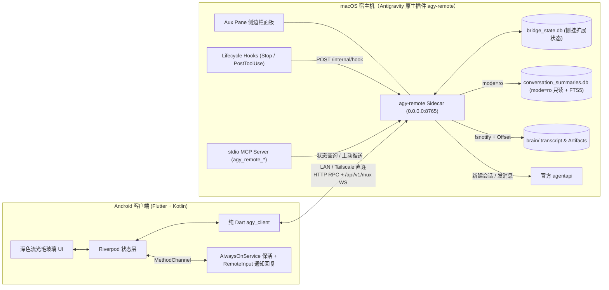

<div align="center">

# AGY Go (`agy-remote`)

**把 Mac 上的 Google Antigravity 装进口袋：随时随地查看配额、跟进会话、审阅产物、锁屏拍板。**

由 **macOS 原生 Antigravity 插件（`agy-remote`）** 与 **Android 客户端（Flutter + Kotlin 原生层）** 组成，通过局域网 / Tailscale 点对点直连，零第三方云端中转。


-34D399?style=flat-square)


</div>

---

## 界面预览

<p align="center">
  
</p>

- **顶部双玻璃胶囊栏**：左侧查看实时直连状态与通知中心（带未读红点），右侧提供全库全文检索（`🔍`）与新建 Antigravity 会话（`+`）。
- **可折叠配额仪表盘**：实时展示宿主机直连状态与延迟、订阅层级，以及 `Gemini`、`Claude · GPT` 双模型池的 `5h` / `7d` 剩余额度与重置倒计时（长按任意池可手动微调校准基准）。
- **双视图高密度会话流**：支持在 `桌面顺序` 与 `按项目` 之间一键切换；卡片内聚展示未读蓝点、标题、时间、正文预览、工作区归属、当前模型与推理档位、子代理与产物角标。

---

## 为什么做 AGY Go？

AGY Go 的目标**不是**在手机小屏上写代码，也**不在**手机本地塞入 Linux 容器或离线跑大模型，而是将运行在 Mac 上的 Google Antigravity 延伸为全天候随身监控、远程指挥与实时拍板的移动控制台：

- **点对点直连，零云端中转**：扫码一次性录入局域网 IPv4、Tailscale（`100.64.0.0/10`）或自定义反向代理端点，客户端并发探测优选并强制 Bearer Token 鉴权。
- **桌面数据库零写入风险**：对 Antigravity 原生 `conversation_summaries.db` 严格采用 `mode=ro` 只读查询，移动端置顶与已读游标独立存放在 `~/.config/antigravity-mobile/bridge_state.db`；发消息与新建会话统一交由官方 `agentapi` 执行。
- **宿主插件一体化托管**：安装 `agy-remote` 后由 Antigravity 自动托管 Sidecar、MCP 服务与 Lifecycle Hooks，开箱即用，无需手动在终端常驻守护进程。

---

## 核心功能一览

### 1. Mac 端原生插件 `agy-remote`（`plugin/` + `bridge/`）

| 能力模块 | 核心特性 |
| :--- | :--- |
| **托管 Sidecar 与 Aux Pane 面板** | 启用插件后自动在后台启动 `agy-remote sidecar`（默认 `0.0.0.0:8765`）；在 Antigravity 右侧边栏即可直接扫码配对、查看在线手机数与 `5h/7d` 配额、一键测试通知或轮换访问密钥。 |
| **Lifecycle Hooks 毫秒推送** | 挂载 `Stop`（任务完成）与 `PostToolUse(ask_question)`（等待决策/确认），事件触发后通过本地回环 `/internal/hook` 即时推送到手机。 |
| **内置 stdio MCP 工具** | 向 Agent 暴露 `agy_remote_status`、`agy_remote_pairing_info`、`agy_remote_notify_mobile`，让 Agent 或定时任务可主动向手机推送进度汇报、待确认提示与快捷回复按钮。 |
| **本地数据与安全沙箱** | 只读查询 `conversation_summaries.db`（含子代理计数与 FTS5 全文检索）；基于 `fsnotify` + 字节偏移增量监听 `brain/` 会话与 Artifacts；白名单路径 + `EvalSymlinks` 校验安全读取本地 `file:///` 引用文件。 |

### 2. Android 客户端（`app/`：Flutter + 纯 Dart `agy_client` + Kotlin）

| 能力模块 | 核心特性 |
| :--- | :--- |
| **多路竞速与断线自愈** | 支持局域网 / Tailscale / 自定义端点并发握手测速；Wi-Fi 与 5G 切换自动重连，并按 `seq` 增量快照补齐离线消息。 |
| **流式阅读与原生预览** | 自动折叠连续思考（`thinking`）与工具调用（`tool_calls`）为单行摘要胶囊；内置 Artifacts 抽屉与 `file:///` 原生预览器（支持 Markdown 渲染、代码复制与图片缩放）。 |
| **单手盲操悬浮气泡** | 右下拇指区悬浮胶囊：浏览历史时一键回到底部；当会话处于待确认状态时自动展示「一键确认开工」，单手大拇指即可完成拍板。 |
| **前台保活与通知栏闭环** | Kotlin `AlwaysOnService` 前台保活 + `AlertNotifier` / `AlertActionReceiver`，支持在锁屏或下拉通知栏通过 Android 原生 `RemoteInput` 直接回复或点击快捷按钮，无需解锁进入 App。 |

---

## 系统架构与仓库结构



```text
antigravity-mobile/
├── plugin/                   # Antigravity 原生插件清单与资源（plugin.json, hooks.json, mcp_config.json, sidecars/, skills/, rules/）
├── bridge/                   # Mac 端 Go 单二进制源码（cmd/agy-bridge + internal/* 核心模块）
├── app/                      # Flutter 客户端工程（lib/ + android/ Kotlin 原生保活与通知回复）
│   └── packages/agy_client/  # 零 Flutter 依赖的纯 Dart 协议与状态归约包（可独立跑 dart test）
├── scripts/                  # 一键部署插件（install-plugin.sh）、全栈门禁（verify.sh）与运行态冒烟（smoke-live.sh）
├── assets/screenshots/       # README 展示截图
└── AGENTS.md                 # 仓库工程纪律与交付门禁说明
```

---

## 快速开始

### 方式一：直接下载 GitHub Releases 成品安装（推荐，无需 Go / Flutter 环境）

前往仓库 [Releases 页面](https://github.com/wo120/agy-go/releases) 下载对应平台产物：

| 目标端 | 下载文件 | 安装位置 / 方式 |
| :--- | :--- | :--- |
| **macOS（Apple Silicon）** | `agy-remote-macos-arm64.tar.gz` | 解压到 `~/.gemini/config/plugins/` |
| **macOS（Intel）** | `agy-remote-macos-amd64.tar.gz` | 解压到 `~/.gemini/config/plugins/` |
| **Windows（64位）** | `agy-remote-windows-amd64.zip` | 解压到 `%USERPROFILE%\.gemini\config\plugins\` |
| **Android 手机** | `app-android-arm64.apk` | 手机直接安装 |
| **华为 Mate 80 / Pura 80（纯血鸿蒙）** | `app-harmonyos-80-arm64.apk` | 通过手机「文件管理 → **卓易通**」打开安装 |

#### 桌面端扩展安装教程

**1. macOS 安装（终端执行）：**
```bash
mkdir -p ~/.gemini/config/plugins
tar -xzf ~/Downloads/agy-remote-macos-arm64.tar.gz -C ~/.gemini/config/plugins
# 若 macOS Gatekeeper 提示未知开发者，解除隔离属性即可：
xattr -dr com.apple.quarantine ~/.gemini/config/plugins/agy-remote
```

**2. Windows 安装（PowerShell 执行或图形化解压）：**
```powershell
New-Item -ItemType Directory -Force -Path "$env:USERPROFILE\.gemini\config\plugins" | Out-Null
Expand-Archive -Force "$env:USERPROFILE\Downloads\agy-remote-windows-amd64.zip" "$env:USERPROFILE\.gemini\config\plugins"
```
> 解压后请确认目录结构为 `...\.gemini\config\plugins\agy-remote\plugin.json`（不要多套一层目录）。

**3. 在 Antigravity 中启用扩展并配对手机：**
1. 打开桌面端 **Google Antigravity**，进入插件管理页启用 **`agy-remote`**（插件会自动在后台拉起 Sidecar 服务）。
2. 打开右侧边栏 **`agy-remote`** 面板，即可看到配对二维码、当前局域网 / Tailscale 地址以及 `5h/7d` 配额。
3. 在手机端打开 **AGY Go**，点击左上角无线图标 →「打开相机扫描二维码」（若容器环境相机不可用，可复制面板中的配对 JSON 在「方式二」粘贴导入）。

---

### 方式二：从源码编译安装（开发者）

#### 前置环境

- **桌面端**：macOS / Windows + Google Antigravity + Go `1.24+`
- **Android 设备**：Android `8.0+`（`minSdk = 26`，`arm64` 架构）
- **编译 APK 额外依赖**：Flutter SDK、JDK 17、Android SDK

#### 1. 一键安装桌面端 Antigravity 插件 `agy-remote`（macOS / Windows）

**macOS / Linux：**
```bash
cd /Users/apple/go-project/ai/antigravity-mobile
./scripts/install-plugin.sh
```

**Windows（PowerShell）：**
```powershell
.\scripts\install-plugin.ps1
```

**跨平台批量打包发布压缩包（输出到 `dist/`）：**
```bash
./scripts/package-plugin.sh
```

脚本会自动编译 Go 单二进制并安装插件到 `~/.gemini/config/plugins/agy-remote/`（Windows 为 `%USERPROFILE%\.gemini\config\plugins\agy-remote\`；若旧版 Sidecar 正在运行会自动平滑重启）。如需脱离 Antigravity 单独调试或终端配对，支持直接运行：
```bash
~/.gemini/config/plugins/agy-remote/bin/agy-remote <serve|sidecar|mcp|hook|pair|status>
```

#### 2. 编译与安装 Android / 鸿蒙兼容 APK

```bash
cd /Users/apple/go-project/ai/antigravity-mobile/app
JAVA_HOME=/opt/homebrew/opt/openjdk@17/libexec/openjdk.jdk/Contents/Home \
ANDROID_HOME=/opt/homebrew/share/android-sdk \
PUB_HOSTED_URL=https://pub.flutter-io.cn \
FLUTTER_STORAGE_BASE_URL=https://storage.flutter-io.cn \
flutter --no-version-check --suppress-analytics build apk --release --target-platform android-arm64

# 华为 Mate 80 / Pura 80（纯血鸿蒙 + 卓易通）兼容包：
ORG_GRADLE_PROJECT_harmonyCompat=true \
flutter --no-version-check --suppress-analytics build apk --release --target-platform android-arm64

# 安装到开启 USB 调试的安卓手机
adb install -r build/app/outputs/flutter-apk/app-release.apk
```

#### 3. 安卓后台保活建议（小米 HyperOS 等）

1. 配对后 App 会请求通知权限并启动极低干扰的常驻连接通知。
2. 在「主机连接与配对 → 系统防杀后台 / 电池设置」中将本应用设为**无限制省电策略**并允许**自启动**，即可在锁屏状态下即时收到 Agent 决策提醒，并直接在通知栏输入回复或一键确认开工。

---

## 开发规范与全栈验证（Done Gate）

仓库采用严格的工程纪律与行为测试基线（详见 [AGENTS.md](AGENTS.md)）。提交或部署任何代码改动前，请执行：

```bash
# 一键全栈 Done Gate 门禁：
# 1) Go vet & -race 单测  2) 插件清单与回归守卫  3) 纯 Dart agy_client 分析与单测  4) Flutter analyze & widget 测试
./scripts/verify.sh

# 涉及运行态 / 接口 / 插件改动时，对本地 Sidecar (127.0.0.1:8765) 执行实测冒烟：
./scripts/smoke-live.sh
```

> 修改 `bridge/` 或 `plugin/` 后，务必重新执行 `./scripts/install-plugin.sh` 重新编译部署并重启 Sidecar 进程。

---

## 常见问题（FAQ）

<details>
<summary><strong>Q：电脑上的 Antigravity 桌面端没启动时，手机端还能用吗？</strong></summary>
可以只读使用。只要 Mac 端的 `agy-remote`（或独立 `agy-remote serve`）在线，历史会话浏览、FTS5 全文检索、Artifacts/本地白名单文件预览以及配额快照均正常可用；仅「新建会话」和「发送消息」需要 Antigravity 桌面进程在线。
</details>

<details>
<summary><strong>Q：出门脱离家里 Wi-Fi 后切到 5G 还能连接 Mac 吗？</strong></summary>

可以。在 Mac 上登录 Tailscale 后，插件生成配对二维码时会自动同时包含局域网 IPv4 与 Tailscale 虚拟网段（`100.64.0.0/10`）地址（也支持在 `~/.config/antigravity-mobile/config.json` 的 `publicEndpoints` 中配置自建反向代理）。手机切网后会自动重新探测并无感切换链路。
</details>

<details>
<summary><strong>Q：读取桌面端数据会不会损坏或锁死 Antigravity 的数据库？</strong></summary>

不会。`bridge/` 对 `~/.gemini/antigravity/conversation_summaries.db` 严格使用只读模式打开（`mode=ro` + `query_only` + `busy_timeout`），绝不写入桌面端原生数据库。
</details>
