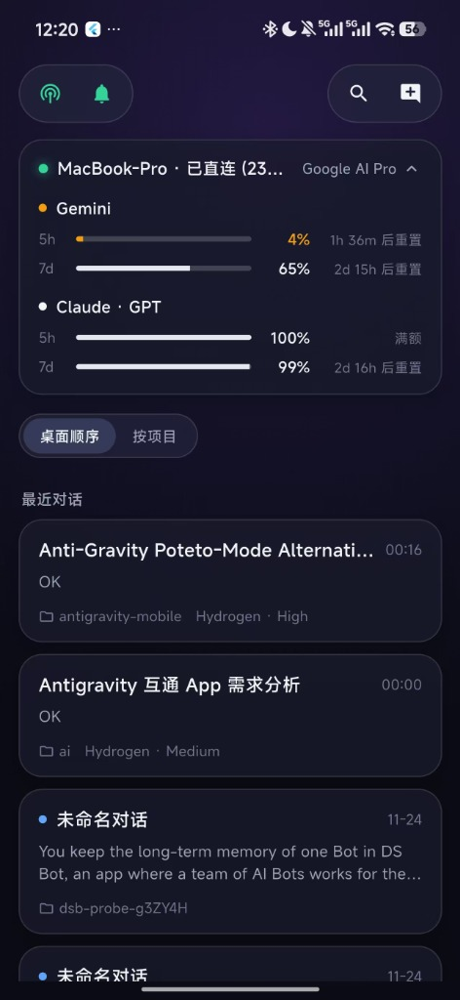
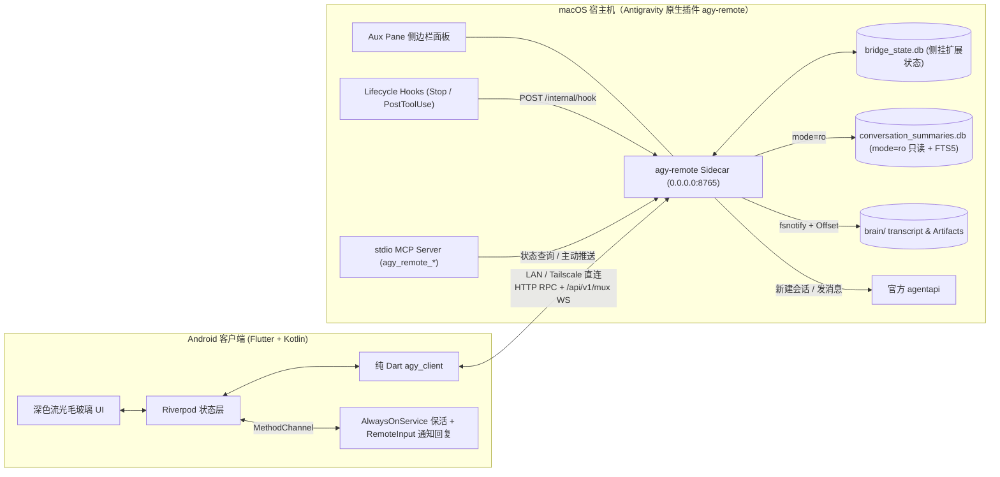

<div align="center">

# AGY Go (`agy-remote`)

**把电脑上的 Google Antigravity 装进口袋：随时随地查看配额、跟进会话、审阅产物、锁屏拍板。**

由 **桌面端 Antigravity 原生插件（`agy-remote`，支持 macOS / Windows）** 与 **手机端 App（支持 Android / 华为纯血鸿蒙卓易通）** 组成，支持 **局域网直连** 与 **内置 Tailscale Funnel 5G 公网直连**，零第三方云端中转、手机端无需装 VPN。


</div>

---

## 界面预览

<p align="center">
  
</p>

- **顶部双玻璃胶囊栏**：左侧查看实时直连状态与通知中心（带未读红点），右侧提供全库全文检索（`🔍`）与新建 Antigravity 会话（`+`）。
- **可折叠配额仪表盘**：实时展示宿主机直连状态与延迟、订阅层级，以及 `Gemini`、`Claude · GPT` 双模型池的 `5h` / `7d` 剩余额度与重置倒计时（长按任意池可手动微调校准基准）。
- **双视图高密度会话流**：支持在 `桌面顺序` 与 `按项目` 之间一键切换；卡片内聚展示未读蓝点、标题、时间、正文预览、工作区归属、当前模型与推理档位、子代理与产物角标。

---

## 为什么做 AGY Go？

AGY Go 的目标**不是**在手机小屏上写代码，也**不在**手机本地塞入 Linux 容器或离线跑大模型，而是将运行在 Mac 上的 Google Antigravity 延伸为全天候随身监控、远程指挥与实时拍板的移动控制台：

- **点对点直连，零云端中转**：扫码一次性录入局域网 IPv4、Tailscale（`100.64.0.0/10`）或自定义反向代理端点，客户端并发探测优选并强制 Bearer Token 鉴权。
- **桌面数据库零写入风险**：对 Antigravity 原生 `conversation_summaries.db` 严格采用 `mode=ro` 只读查询，移动端置顶与已读游标独立存放在 `~/.config/antigravity-mobile/bridge_state.db`；发消息与新建会话统一交由官方 `agentapi` 执行。
- **宿主插件一体化托管**：安装 `agy-remote` 后由 Antigravity 自动托管 Sidecar、MCP 服务与 Lifecycle Hooks，开箱即用，无需手动在终端常驻守护进程。

---

## 核心功能一览

### 1. 桌面端原生插件 `agy-remote`（`plugin/` + `bridge/`）

| 能力模块 | 核心特性 |
| :--- | :--- |
| **托管 Sidecar 与侧边栏面板** | 启用插件后自动在后台启动 `agy-remote sidecar`（默认 `0.0.0.0:8765`）；在 Antigravity 右侧边栏即可直接扫码配对、查看在线手机数与真实 `5h/7d` 配额、一键测试通知或重置密钥。 |
| **内置 5G 远程直连（Tailscale Funnel）** | Go 二进制直接内嵌官方 `tsnet`，电脑免装 Tailscale 客户端；侧边栏点击按钮用 GitHub 授权即可生成固定公网 HTTPS 域名，自动写入二维码并自带保活自愈，手机端零安装直接 5G 连接。 |
| **Lifecycle Hooks 毫秒推送** | 挂载 `Stop`（任务完成）与 `PostToolUse(ask_question)`（等待决策/确认），事件触发后通过本地回环 `/internal/hook` 即时推送到手机。 |
| **内置 stdio MCP 工具** | 向 Agent 暴露 `agy_remote_status`、`agy_remote_pairing_info`、`agy_remote_notify_mobile`，让 Agent 或定时任务可主动向手机推送进度汇报、待确认提示与快捷回复按钮。 |
| **本地数据与安全沙箱** | 只读查询 `conversation_summaries.db`（含子代理计数与 FTS5 全文检索）；基于 `fsnotify` + 字节偏移增量监听 `brain/` 会话与 Artifacts；白名单路径 + `EvalSymlinks` 校验安全读取本地 `file:///` 引用文件。 |

### 2. 手机端客户端（`app/`：Flutter + 纯 Dart `agy_client` + Kotlin）

| 能力模块 | 核心特性 |
| :--- | :--- |
| **Wi-Fi / 5G 自动切换与断线自愈** | 支持局域网 / Tailscale / 公网 HTTPS 多地址并发竞速；原生监听系统网络切换，在家秒连局域网、出门关 Wi-Fi 自动切 5G 公网，并按 `seq` 快照自动补齐离线消息。 |
| **极速加载与原生预览** | 服务端自动裁剪非渲染日志 + HTTP gzip + WebSocket 帧压缩（体积直降 90%+）；客户端内置最近会话 LRU 缓存二次打开 0ms 秒开；支持 Artifacts 抽屉与 `file:///` 原生预览（Markdown / 代码 / 图片）。 |
| **单手盲操悬浮气泡** | 右下拇指区悬浮胶囊：浏览历史时一键回到底部；当会话处于待确认状态时自动展示「一键确认开工」，单手大拇指即可完成拍板。 |
| **前台保活与通知栏闭环** | Kotlin `AlwaysOnService` 前台保活 + `AlertNotifier` / `AlertActionReceiver`，支持在锁屏或下拉通知栏通过 Android 原生 `RemoteInput` 直接回复或点击快捷按钮，无需解锁进入 App。 |

---

## 系统架构与仓库结构



```text
antigravity-mobile/
├── plugin/                   # Antigravity 原生插件清单与资源（plugin.json, hooks.json, mcp_config.json, sidecars/, skills/, rules/）
├── bridge/                   # Mac 端 Go 单二进制源码（cmd/agy-bridge + internal/* 核心模块）
├── app/                      # Flutter 客户端工程（lib/ + android/ Kotlin 原生保活与通知回复）
│   └── packages/agy_client/  # 零 Flutter 依赖的纯 Dart 协议与状态归约包（可独立跑 dart test）
├── scripts/                  # 一键部署插件（install-plugin.sh）、全栈门禁（verify.sh）与运行态冒烟（smoke-live.sh）
├── assets/screenshots/       # README 展示截图
└── AGENTS.md                 # 仓库工程纪律与交付门禁说明
```

---

## 快速开始（3 分钟零代码上手）

> **完全不会写代码也能轻松装好！** 整个过程只需要 **下载 2 个文件**（1 个装在电脑上，1 个装在手机上），然后**扫一下二维码**就能用。

---

### 第 1 步：去 Releases 下载对应的 2 个文件

打开项目的 **[Releases 发布页](https://github.com/wo120/agy-go/releases/latest)**，根据你的设备各选 **1 个** 下载：

#### A. 电脑端扩展（选 1 个）

| 你的电脑 | 下载这个文件 | 怎么看自己的电脑型号？ |
| :--- | :--- | :--- |
| **苹果 Mac（M1 / M2 / M3 / M4 芯片）** | `agy-remote-macos-arm64.tar.gz` | 点屏幕左上角 `` →「关于本机」，芯片写着 Apple M 系列就选它 |
| **苹果 Mac（老款 Intel 芯片）** | `agy-remote-macos-amd64.tar.gz` | 「关于本机」里处理器写着 Intel 就选它 |
| **Windows 电脑（Win 10 / Win 11 64位）** | `agy-remote-windows-amd64.zip` | 绝大多数 Windows 电脑直接选它 |

#### B. 手机端 App（选 1 个）

| 你的手机 | 下载这个文件 | 说明 |
| :--- | :--- | :--- |
| **普通安卓手机**（小米 / OPPO / vivo / 三星 / Pixel / 鸿蒙 4.x） | `app-android-arm64.apk` | 发到手机直接点击安装 |
| **华为纯血鸿蒙手机**（Mate 80 / Pura 80 等 HarmonyOS 5/NEXT） | `app-harmonyos-80-arm64.apk` | 通过「文件管理 → **卓易通**」打开安装 |

---

### 第 2 步：在电脑上安装 `agy-remote` 插件

<details open>
<summary><strong>🍎 苹果 Mac 安装教程（复制 1 段命令，10 秒搞定）</strong></summary>

1. 确保刚下载的 `agy-remote-macos-arm64.tar.gz`（Intel 芯片为 `amd64`）在你的「下载」文件夹里。
2. 按 `Command + 空格`，输入 `终端` 回车打开黑色终端窗口。
3. **整段复制下面命令粘贴进去，按回车**（Intel 芯片请把文件名里的 `arm64` 改成 `amd64`）：

```bash
mkdir -p ~/.gemini/config/plugins && \
tar -xzf ~/Downloads/agy-remote-macos-arm64.tar.gz -C ~/.gemini/config/plugins && \
xattr -dr com.apple.quarantine ~/.gemini/config/plugins/agy-remote
```

> 看到没有红色报错就装好了！（第三行是解除苹果系统的“未知开发者”拦截提示，必不可少。）

</details>

<details open>
<summary><strong>🪟 Windows 安装教程（纯鼠标操作，不用敲命令）</strong></summary>

**方式 A：纯鼠标解压（推荐小白）**
1. 右键点击下载好的 `agy-remote-windows-amd64.zip` → 选择「全部解压缩」，得到一个 **`agy-remote`** 文件夹（点进去应该能直接看到 `plugin.json`）。
2. 同时按下键盘 `Win + R` 打开“运行”窗口，输入下面路径后回车：
   ```text
   %USERPROFILE%\.gemini\config
   ```
3. 如果里面没有 `plugins` 文件夹，右键新建一个名为 `plugins` 的文件夹并点进去。
4. 把第 1 步解压出来的整个 **`agy-remote`** 文件夹拖进去即可。

> **检查是否放对位置**：最终路径应为 `C:\Users\你的用户名\.gemini\config\plugins\agy-remote\plugin.json`（注意不要多套一层 `agy-remote\agy-remote`）。

**方式 B：PowerShell 一键命令**
```powershell
New-Item -ItemType Directory -Force -Path "$env:USERPROFILE\.gemini\config\plugins" | Out-Null
Expand-Archive -Force "$env:USERPROFILE\Downloads\agy-remote-windows-amd64.zip" "$env:USERPROFILE\.gemini\config\plugins"
```

</details>

**启用插件：**
1. 打开（或重启）电脑上的 **Google Antigravity**。
2. 打开插件管理页（Plugins Manager），找到 **`agy-remote`** 并把开关打开。
3. 打开 Antigravity 右侧边栏的 **`agy-remote`** 面板——看到**白色二维码**就说明电脑端启动成功了！

---

### 第 3 步：在手机上安装 App 并扫码连接

#### 1. 安装手机端
- **普通安卓手机**：把 `app-android-arm64.apk` 通过微信文件传输助手/QQ/数据线传到手机，点击文件安装（系统提示“未知来源”点允许即可）。
- **华为纯血鸿蒙（Mate 80 / Pura 80 等）**：
  1. 先在华为应用市场搜索并安装 **「卓易通」**（如果还没装过）。
  2. 把 `app-harmonyos-80-arm64.apk` 保存到手机后，打开系统自带的 **「文件管理」** 找到该文件，选择用 **「卓易通」** 打开安装。

#### 2. 扫码配对（连上同一 Wi-Fi 立即可用）
1. 打开手机上的 **AGY Go** App，点击页面中间的扫码卡片（或左上角无线图标）。
2. 点击 **「打开相机扫描二维码」**，对准电脑 Antigravity 右侧面板里的二维码扫一下即可自动连上！
   > 若个别容器环境相机无法打开，直接点电脑面板里的 **「复制配对 JSON」**，发到手机粘贴进 App 的 **「方式二：粘贴配对 JSON」** 点「导入 JSON」同样生效。

---

### 第 4 步（可选）：开启出门 5G 远程直连（手机零安装、免 VPN）

如果只在家/公司同一 Wi-Fi 下用，做到第 3 步就已经完成了。如果你想**出门切 5G 流量也能随时看进度、给 Agent 拍板**（包括纯血鸿蒙手机），只需在电脑端操作一次（全程约 1 分钟，手机端无需装任何软件）：

1. 在电脑 Antigravity 右侧 **`agy-remote`** 面板里，找到 **「5G 远程直连（内置 Tailscale Funnel）」** 卡片，点击 **「开启 5G 远程（支持 GitHub 授权）」**。
2. 几秒后会出现蓝色按钮 **「前往登录（GitHub / Google 授权）」**，点开后在浏览器用你的 GitHub（或 Google）账号授权登录。
3. **首次使用开启一次 HTTPS 与 Funnel**（免费，终身只需设这一次）：
   - 打开 [Tailscale DNS 设置页](https://login.tailscale.com/admin/dns) → 确认 **MagicDNS** 已开启 → 拉到最底部点击 **Enable HTTPS**；
   - 打开 [Tailscale 权限设置页 (Access Controls)](https://login.tailscale.com/admin/acls) → 确认策略里有 `"funnel"` 权限（如果没有，在最外层最后一个 `}` 前加上下面几行后点底部 **Save**）：
     ```json
     "nodeAttrs": [
       {
         "target": ["autogroup:member"],
         "attr": ["funnel"]
       }
     ]
     ```
4. 回到电脑右侧 `agy-remote` 面板，等待几秒（或点「已开启，立即重试」），右上角变绿显示 **`5G 已就绪`**，并且出现以 `https://agy-xxx.ts.net` 开头的公网地址。
5. **用手机重新扫一次新二维码**！以后手机在家自动毫秒级走局域网（`已直连`），出门关 Wi-Fi 自动无缝切到 **`公网5G`**。

> **后台防杀建议（安卓手机）**：在 App 里进入「左上角无线图标 → **系统防杀后台 / 电池设置**」，把 AGY Go 设为**无限制省电**并允许**自启动**，就能在锁屏时第一时间收到 Agent 提醒并在通知栏直接回复。

---

<details>
<summary><strong>🛠️ 开发者选项：从源码编译安装与全栈门禁（普通用户无需展开）</strong></summary>

#### 前置环境
- **桌面端**：macOS / Windows + Google Antigravity + Go `1.24+`
- **Android 设备**：Android `8.0+`（`minSdk = 26`，`arm64` 架构）
- **编译 APK 额外依赖**：Flutter SDK、JDK 17、Android SDK

#### 1. 编译安装桌面端插件 `agy-remote`
```bash
# macOS / Linux 一键编译部署并平滑重启 Sidecar：
./scripts/install-plugin.sh

# 跨平台批量打包发布压缩包（输出到 dist/）：
./scripts/package-plugin.sh
```
Windows（PowerShell）：
```powershell
.\scripts\install-plugin.ps1
```

#### 2. 编译 Android / 纯血鸿蒙兼容 APK
```bash
cd app
JAVA_HOME=/opt/homebrew/opt/openjdk@17/libexec/openjdk.jdk/Contents/Home \
ANDROID_HOME=/opt/homebrew/share/android-sdk \
PUB_HOSTED_URL=https://pub.flutter-io.cn \
FLUTTER_STORAGE_BASE_URL=https://storage.flutter-io.cn \
flutter --no-version-check --suppress-analytics build apk --release --target-platform android-arm64

# 华为 Mate 80 / Pura 80（纯血鸿蒙 + 卓易通）兼容包：
ORG_GRADLE_PROJECT_harmonyCompat=true \
flutter --no-version-check --suppress-analytics build apk --release --target-platform android-arm64
```

#### 3. 开发规范与全栈验证（Done Gate）
```bash
# 1) Go vet & -race 单测  2) 插件清单守卫  3) 纯 Dart agy_client 测试  4) Flutter analyze & widget 测试
./scripts/verify.sh

# 涉及运行态 / 接口 / 插件改动时，对本地 Sidecar (127.0.0.1:8765) 执行实测冒烟：
./scripts/smoke-live.sh
```

</details>

---

## 常见问题（FAQ）

<details>
<summary><strong>Q：电脑上的 Antigravity 桌面端没启动时，手机端还能用吗？</strong></summary>
可以只读使用。只要 Mac 端的 `agy-remote`（或独立 `agy-remote serve`）在线，历史会话浏览、FTS5 全文检索、Artifacts/本地白名单文件预览以及配额快照均正常可用；仅「新建会话」和「发送消息」需要 Antigravity 桌面进程在线。
</details>

<details>
<summary><strong>Q：出门脱离家里 Wi-Fi 后切到 5G 还能连接电脑吗？</strong></summary>

可以，而且**手机端（包括纯血鸿蒙）不需要装任何 VPN 或 Tailscale**。只需按上面「第 4 步」在电脑侧边栏点一次「开启 5G 远程」完成授权并重新扫码，以后手机在家走局域网、出门自动切到 `公网5G`（也支持在 `~/.config/antigravity-mobile/config.json` 的 `publicEndpoints` 中填自建国内服务器反代，延迟更低）。
</details>

<details>
<summary><strong>Q：纯血鸿蒙手机切 5G 后显示「加载会话中」或连不上怎么办？</strong></summary>

1. 打开 App 左上角无线图标，查看「候选节点」列表里是否包含 `https://agy-xxx.ts.net`；如果只有 `192.168.x.x` 局域网地址，请在电脑端开启 5G 远程后**重新扫一次二维码**。
2. 若电脑端开启了代理软件（如 Clash），把对 `tailscale.com` / `ts.net` 的节点切到**香港或新加坡**低延迟节点，5G 首次连接会明显更快。
</details>

<details>
<summary><strong>Q：读取桌面端数据会不会损坏或锁死 Antigravity 的数据库？</strong></summary>

不会。`bridge/` 对 `~/.gemini/antigravity/conversation_summaries.db` 严格使用只读模式打开（`mode=ro` + `query_only` + `busy_timeout`），绝不写入桌面端原生数据库。
</details>
