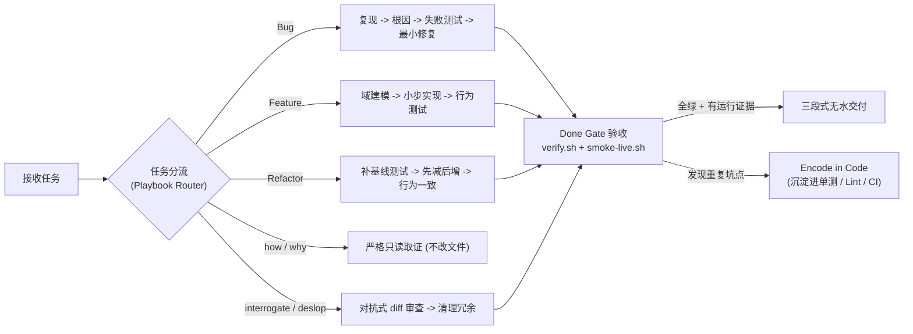

# Lauren（pstack）工程工作流实战指南

> 本指南整理自 Lauren Tan (`@poteto`) 的 **pstack / poteto-mode** 工程纪律方法论，并结合 **AGY Go（`agy-remote` + Android 客户端）** 的实际工具链与自动化门禁落地，适用于日常开发、排障、重构、审查与多 Agent 协同。

---

## 一、核心理念：Trust Comes First, Parallel Later

**“信任优先，并发随后”** 是 Lauren 工作流的底层信条：

- **痛点**：直接使用 AI 写代码时，最容易翻车的不是速度慢，而是 4 类失控行为——凭直觉猜代码、只贴表面补丁、生成冗余 AI Slop、以及“编译通过就宣称完工”。
- **解法**：先靠**取证、最小改动、真实运行验证、机器护栏**把单兵开发的可靠性建立到可信赖的水准，再按需用多 Agent 并行（`arena` / `swarm`）把产出放大。



---

## 二、七条核心工程原则与红灯自检

| # | 原则 | 一句话要求 | 典型违规红灯 | 本项目实战示例 |
| :--- | :--- | :--- | :--- | :--- |
| 1 | **Evidence First**（证据优先） | 没读真实代码和运行证据，不许下结论 | “看文件名应该是…”、“大概是…” | 锁 `compileSdk = 36` / `ndkVersion` 前先核实本机 SDK 目录；修配额前先实调 `GetUserStatus` 看真实字段 |
| 2 | **Fix Root Causes**（只治根因） | 先复现再定位根因，拒绝表面创可贴 | 空 `catch` 吞错、加 `sleep` 绕竞态 | 手机刷新仍显示旧配额时，用 `lsof`/`ps` 查出旧 Sidecar PID 占端口，并在 `install-plugin.sh` 中补齐自动平滑重启 |
| 3 | **Laziness Protocol**（最小改动） | 只写解决当前问题所需的最小正确代码 | 改 1 个 Bug 顺手重写半个文件、提前造抽象层、留废话注释 | 重命名 `AGY Go` 时只改显示名与通知标题，不改动无关布局或破坏构建脚本 |
| 4 | **Model the Domain First**（域模型先行） | 非平凡功能先定数据结构、错误契约与状态机 | 边写边堆散落布尔标志（`isA && !isB && hasC`） | 纯 Dart 包先定 `BridgeRemoteException` vs `CarrierException` 与 `MuxSeqTracker` 状态机 |
| 5 | **Prove It Works**（无证据不完工） | **编译通过 / 类型通过 ≠ 完成**，必须有真实运行证据 | “代码已改完，理论上没问题” | 必须真跑 `./scripts/verify.sh` 与 `./scripts/smoke-live.sh` 并核对真实输出 |
| 6 | **Test Behavior**（测行为不测实现） | 断言外部可观测行为与持久化结果 | 测试全在 mock 内部私有方法调用次数 | Dart 传输层直接起本地 `HttpServer` / `WebSocket` 测 401、竞速与 `seq` 重同步；Go `notifier` 起 `httptest.Server` 测真实 HTTP 投递 |
| 7 | **Encode in Code**（坑点锁进机器检查） | 踩过两次的坑变成脚本/测试/Lint 拦截，不只写口头约定 | 只在文档加一句“请务必注意不要 xxx” | 把插件 Schema 合法性与“禁止硬编码 `Google AI Ultra` 占位”直接写进 `scripts/verify.sh` 自动化检查 |

---

## 三、七大 Playbook 标准执行流程

### 1. Bug Fix（科学排障流）
1. 锁定现象：期望行为、实际行为、触发输入。
2. 取证定位真实执行入口与调用链（禁止凭印象猜）。
3. **先复现，再动手**：构造最小失败单测或稳定复现命令。
4. 区分表象与根因，执行最小化修复。
5. 回归证明：原失败用例变绿 + 关联模块与 `verify.sh` 全绿。
6. 判断是否需要把防复发检查锁进测试或脚本。

### 2. Feature（功能开发流）
1. 澄清边界与验收标准（有高代价分叉先对齐，不瞎猜）。
2. **域建模先行**：确定类型、API/WS 协议、错误码与影响面。
3. 拆成可独立编译验证的小步，复用既有模块不造多余抽象。
4. 编写覆盖「正常路径 + 关键边界/失败路径」的行为测试。
5. 运行真实端到端验证（CLI / HTTP / Sidecar / 真机）。
6. 交付前过一遍 `git diff` 去水清理（Deslop）。

### 3. Refactor（安全重构流）
1. 先确认目标行为已有基线测试；若缺失，先补基线测试并跑绿。
2. **先减后增**：先删死代码、重复逻辑与多余封装，再做结构提炼。
3. 重构严格不混入新功能；每小步迁移立即跑测试验证外部契约不变。

### 4. Investigate（只读调研流：`how` / `why`）
- **铁律**：严格只读，**绝不修改任何业务文件**。
- **`how`（现在怎么跑）**：找入口 → 沿调用链追踪文件与行号 → 标注状态变更与外部依赖 → 明确区分「代码实证」与「推断」。
- **`why`（当初为什么这么写）**：用 `git log` / `git blame` 查引入提交与设计规范，还原历史约束，不脑补动机。

### 5. Architect（架构与边界设计流）
1. 盘点现有模块边界与依赖方向。
2. 输出最小可行结构（核心数据模型、接口签名、状态流向，严禁循环依赖）。
3. 说明取舍、影响面（blast radius）与兼容/回滚策略。
4. 给出按可验证单元拆解的实施顺序，确认后再编码。

### 6. Interrogate & Deslop（对抗式审查与去水）
- **Interrogate（挑刺拷问）**：基于真实 `git diff` 逐项拷问——边界条件（空值、并发、超时、幂等、权限）能否被击穿？是否破坏旧契约？错误是否被静默吞掉？测试是否真测了行为？
- **Deslop（去水清理）**：删掉只复述代码的废话注释、只调用一次的多余包装、无意义防御分支。
- **分级输出**：按「必须修复（阻塞） / 建议优化 / 可忽略」附带精确文件行号。

### 7. Parallel（并行协同：`arena` / `swarm`）
仅在单兵门禁已稳且并行收益大于协调成本时启用：
- **`arena`（多方案比武）**：面对高不确定性方案分叉，用独立子代理分别实现 2~3 套候选方案，用实测指标与复杂度对比择优合并，丢弃其余分支。
- **`swarm`（分片并行）**：面对互不冲突的独立模块切片，多作者在共享/独立工作副本并行推进，主线程统一合并后跑全量 `verify.sh`。

---

## 四、日常对话快捷口令速查（拿来即用）

在 Antigravity 对话中直接输入以下口令，Agent 会自动按 `.agents/skills/pstack-workflow/SKILL.md` 进入对应模式：

| 口令模式 | 适用场景 | 在 `agy-go` 中的实战示例 |
| :--- | :--- | :--- |
| **`poteto-mode <目标>`** | 总入口：自动选 Playbook 走完整闭环 | `poteto-mode 修复配额卡片顶栏延迟毫秒数被省略号截断的问题` |
| **`how <主题>`** | 只读追踪代码真实调用链 | `how 手机端在锁屏通知栏点击快捷确认后，指令是怎么送回 Mac Antigravity 的` |
| **`why <设计>`** | 只读查 git 历史还原决策背景 | `why agy-bridge 的本地回环请求要显式设置 Proxy: nil` |
| **`architect <需求>`** | 动手前先定数据结构与接口边界 | `architect 给 agy-remote 增加多台 Mac 主机切换与健康探测` |
| **`interrogate`** | 对当前改动做对抗式 Code Review | `interrogate 审查刚才提交的改动，重点查 WebSocket 并发和权限边界` |
| **`deslop`** | 清理 AI 废话注释与冗余抽象 | `deslop 清理 app/lib/ui/chat/chat_screen.dart 里的冗余代码` |
| **`arena <方案分叉>`** | 多方案独立实现对比择优 | `arena 对比 flutter_markdown_plus 与自定义代码块渲染两种方案的滚动帧率` |
| **`swarm <独立切片>`** | 多 Agent 分片并行开发 | `swarm 同时推进：1) 后端 Webhook 管理 RPC；2) 前端配额卡片视觉紧凑化` |

---

## 五、本项目的 Done Gate（完工硬门槛）与运维命令

任何代码改动宣称完成前，必须真实跑通以下门禁：

### 1. 全栈自动化门禁（必跑）
```bash
./scripts/verify.sh
```
包含 5 层硬检查：
1. **Go 后端**：`go vet ./...` + `go test -race ./...`（全部 11 个包竞态检测）
2. **插件与防回归守卫**：校验 `plugin.json` 允许顶层字段、`hooks.json` / `mcp_config.json` / `sidecar.json` 合法性、拦截前端硬编码 `Google AI Ultra` 回归
3. **纯 Dart 协议包**：`dart analyze --fatal-infos` + `dart test`
4. **Flutter 客户端**：`flutter analyze`（启用 `flutter_lints`）+ `flutter test`
5. **CI 同步守卫**：推送至 `main` 或发起 PR 时，[.github/workflows/ci.yml](.github/workflows/ci.yml) 会自动复跑同类检查。

### 2. 本机运行态实测冒烟（改后端 / 插件 / 接口时必跑）
```bash
./scripts/install-plugin.sh   # 编译部署最新插件并自动平滑重启 Sidecar
./scripts/smoke-live.sh       # 实测 127.0.0.1:8765 的 health、401 拦截、direct 配额、会话列表、FTS 与 /etc/passwd 沙箱拦截
```

### 3. 无水交付汇报格式（Unsloped Output）
每次任务结束，交付汇报只保留 3 块硬干货：
1. **改了什么**：改动摘要 + 精确文件路径与行号链接。
2. **如何证明可用**：实际执行的命令、测试通过数或真实接口/界面行为证据；若有未覆盖项必须明说。
3. **原则 / 护栏建议**：关键架构权衡，或值得沉淀为自动化检查的坑点。

---

## 六、工作流文件分布与跨项目复用

本仓库已自包含完整的 Lauren 工作流配置，单独打开或换机 clone 后自动生效：
- 仓库规则入口：[AGENTS.md](../AGENTS.md)
- 技能主文档：[.agents/skills/pstack-workflow/SKILL.md](../.agents/skills/pstack-workflow/SKILL.md)
- Playbook 清单：[.agents/skills/pstack-workflow/references/playbooks.md](../.agents/skills/pstack-workflow/references/playbooks.md)
- 口令速查表：[.agents/skills/pstack-workflow/references/commands-and-principles.md](../.agents/skills/pstack-workflow/references/commands-and-principles.md)
- 一键门禁与冒烟：[scripts/verify.sh](../scripts/verify.sh)、[scripts/smoke-live.sh](../scripts/smoke-live.sh)

> **与其他工作流的分工**：简单问答或单步常规命令直接处理，不加载重流程；日常工程任务默认走 **Lauren / pstack**；仅当需要从零头脑风暴做大型产品规格或明确要求 `TDD` / `superpowers` 时切换至 Superpowers 流程。
